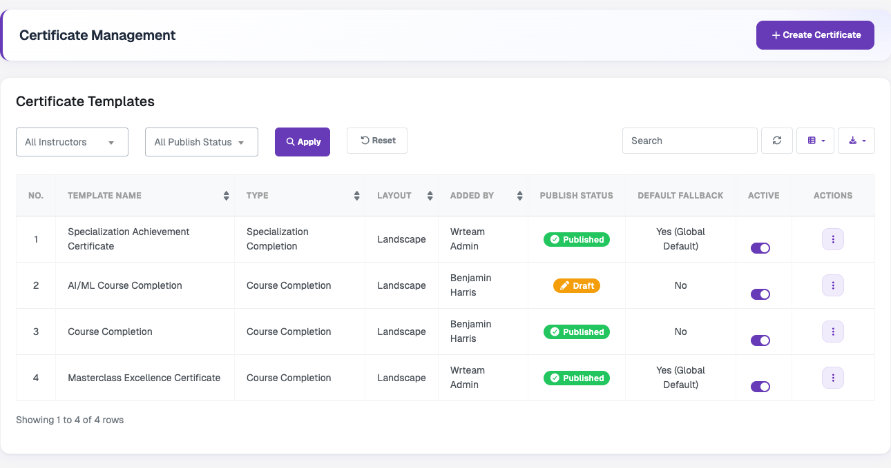
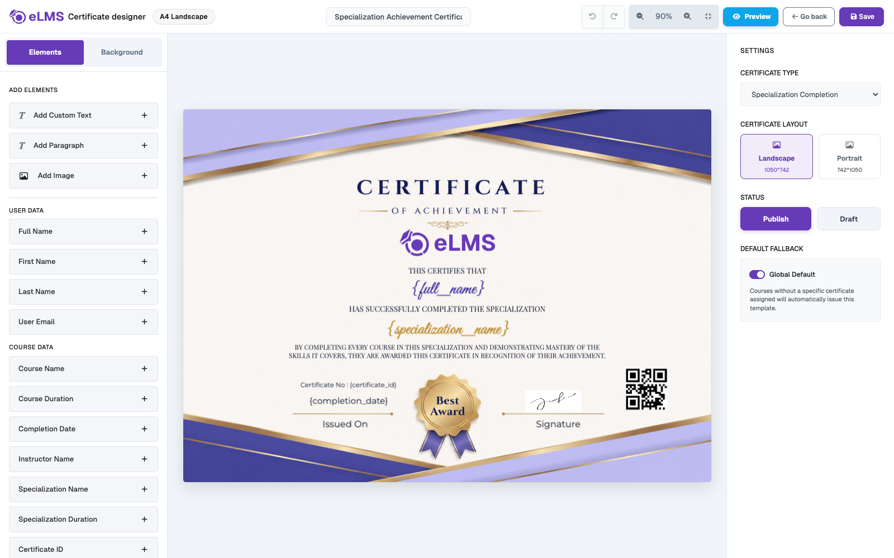
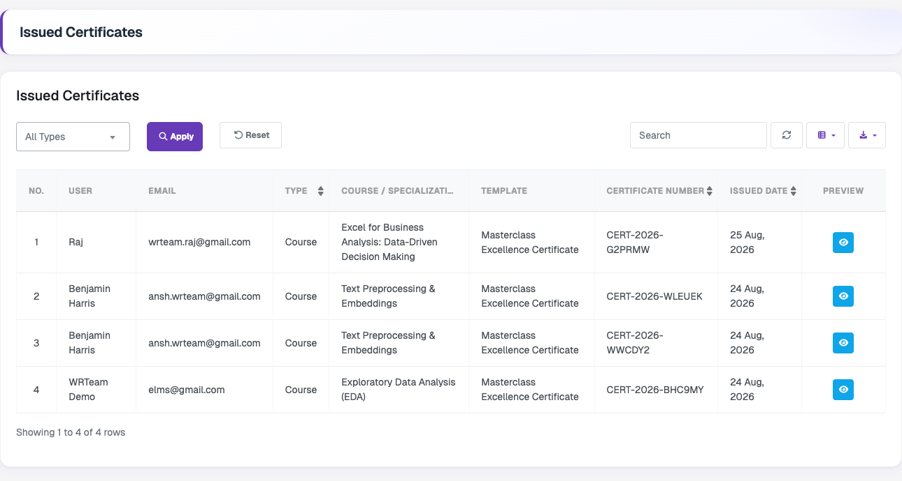

# Certificate Management

Create certificate templates for courses and specializations, and see every certificate that has been issued to learners.

### Manage Certificate

Lists each certificate template with its name, type (**Course Completion** or **Specialization Completion**), layout (landscape or portrait), the user who added it, publish status, default fallback and active status. The list can be filtered by instructor and publish status, searched, refreshed, have columns shown or hidden, and exported. The **Active** switch turns a template on or off, and the actions menu for each template has **Designer**, **Preview** and **Delete**.

Click **Create Certificate** to open the certificate designer.

In the designer you can:

- **Add elements** – custom text, paragraphs and images, plus dynamic data that is replaced automatically when a certificate is issued: **User data** (Full Name, First Name, Last Name, User Email) and **Course data** (Course Name, Course Duration, Completion Date, Instructor Name, Specialization Name, Specialization Duration, Certificate ID).
- **Add a Verification QR Code** under **Security & Verification**, and re-add the platform logo with **Re-add System Logo**.
- **Set the background** from the **Background** tab.
- **Choose the certificate type** – Course Completion or Specialization Completion.
- **Choose the layout** – Landscape (1050×742) or Portrait (742×1050).
- **Set the status** – Publish or Draft.
- **Set a Global Default** – when a course or specialization has no specific certificate assigned, this template is issued automatically.

Enter a template name at the top and click **Save**. Use **Preview** to see the result before saving. Instructors can create their own certificates when **Allow Instructor Certificate** is enabled in [System Settings](/admin-panel/system-settings).

### Issued Certificates

Shows every certificate issued to learners, with the user, email, type (Course or Specialization), the course or specialization, the template used, the certificate number, and the issued date. Filter by type with **All Types**, then **Apply** or **Reset**, and use search, refresh, column and export options as in the other lists. The eye icon in the **Preview** column opens the issued certificate.
