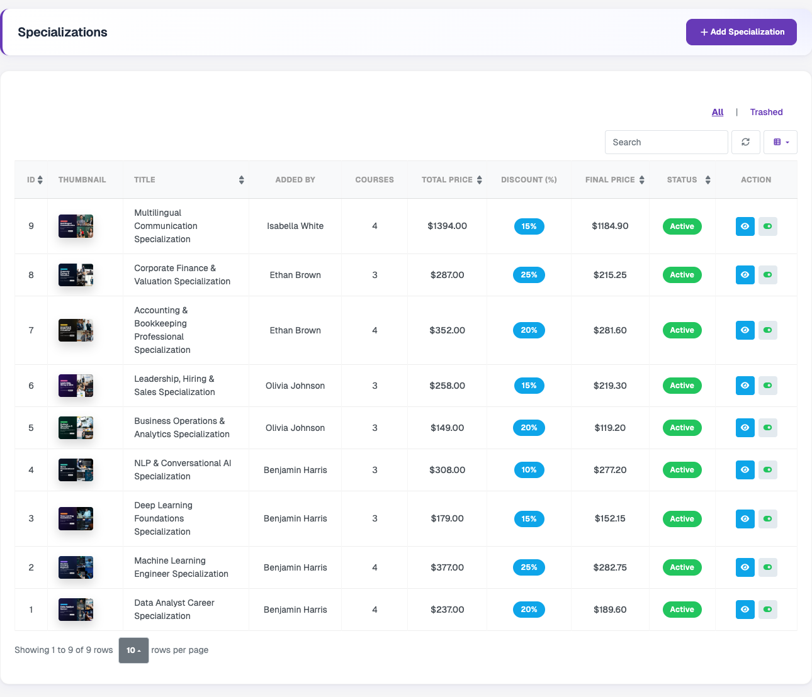
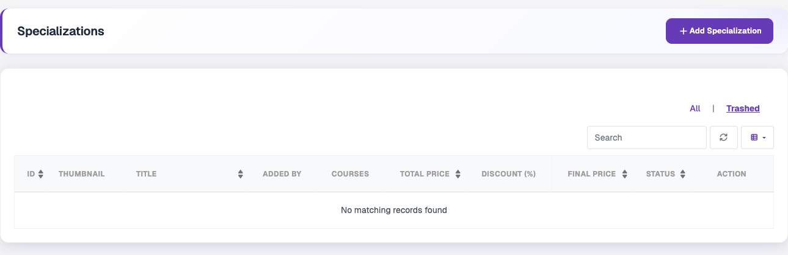
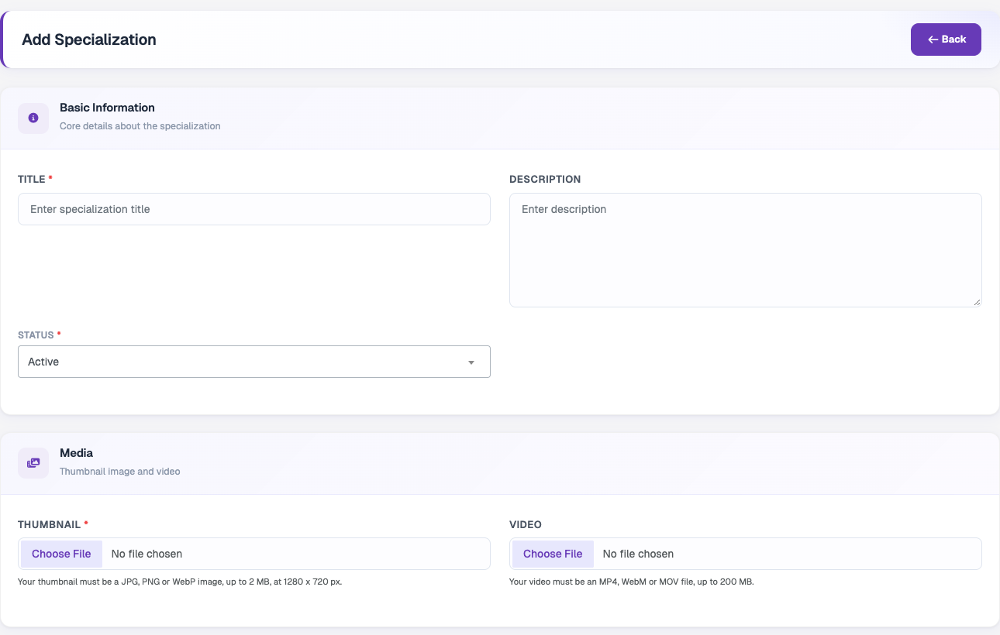
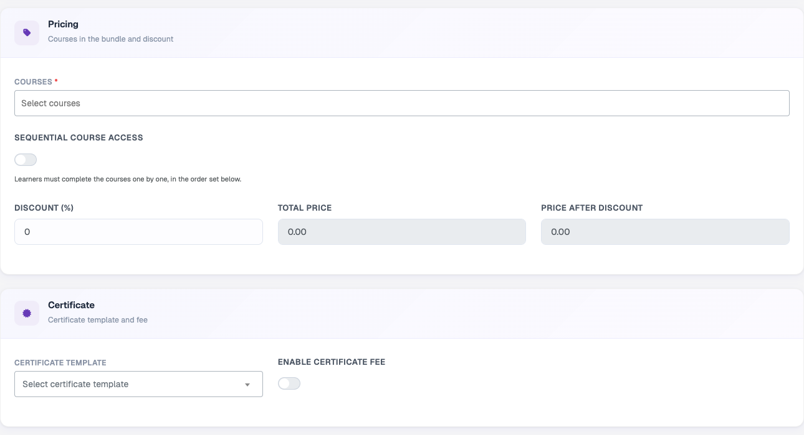
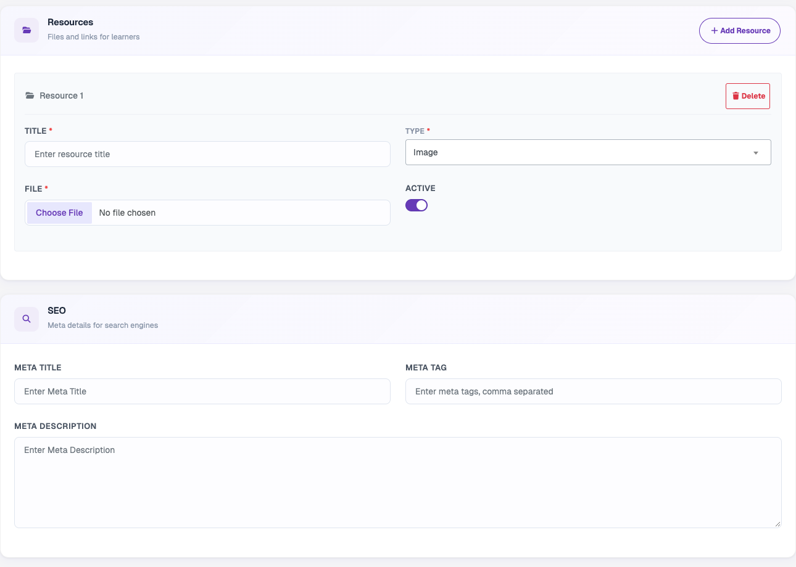
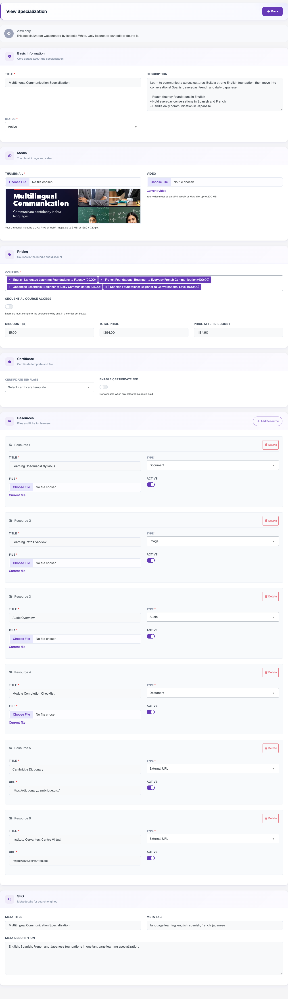
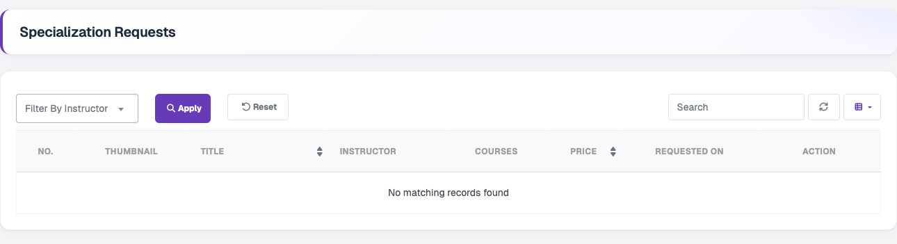

# Specialization

A specialization is a bundle of related courses sold together at a discount, with an optional completion certificate. Learners enrol once and work through all the courses in the bundle. The Specialization menu can be turned on or off with **Enable Specialization** in **Settings → System → Course**.

### Manage Specialization

Lists every specialization with its thumbnail, title, who added it, number of courses, total price, discount, final price and status (Active, Draft or Disabled). The table can be searched, refreshed, sorted and have columns shown or hidden. The eye icon opens the specialization, and the toggle icon enables or disables it without deleting it. Only the creator of a specialization can edit or delete it, so specializations created by instructors open in view-only mode for the admin.

### Trashed Specializations

The **Trashed** tab above the list shows deleted specializations. Use **All** to return to the full list.

### Add Specialization

Click **Add Specialization** to create one. **Basic Information** holds the title, description and status. **Media** holds the thumbnail (JPG, PNG or WebP, up to 2 MB, 1280 x 720 px) and an optional intro video (MP4, WebM or MOV, up to 200 MB).

**Pricing** is where the courses in the bundle are selected. The total price and the price after discount are calculated automatically from the selected courses and the discount percentage. **Sequential Course Access** forces learners to complete the courses one by one, in the selected order. In **Certificate**, choose a certificate template and optionally charge a certificate fee. The fee is not available when any selected course is paid.

**Resources** are extra learning materials. Each resource has a title, a type (Image, Audio, Video, Document or External URL), a file or URL, and an Active switch. **SEO** holds the meta title, meta tags and meta description.

### Edit / View Specialization

Opens the same form with the saved values, including the current video and resource files. A specialization created by the admin can be changed and saved. One created by an instructor is shown as **View only**.

### Specialization Request

Lists specializations submitted by instructors that are waiting for review, with the thumbnail, title, instructor, courses, price and requested date. Requests can be filtered by instructor and searched by title.
