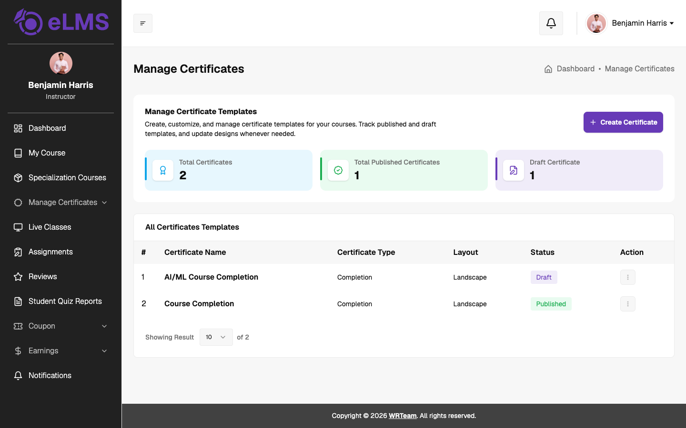
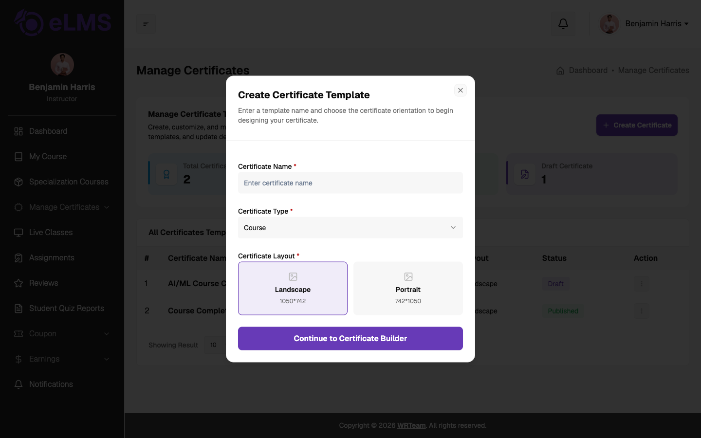
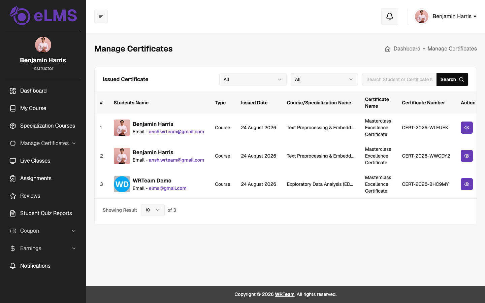

# Manage Certificates

Instructors can design their own certificates and see which certificates have been issued to learners. This is available when **Allow Instructor Certificate** is enabled by the admin in System Settings. Both options are under **Manage Certificates** in the sidebar.

### All Certificate Templates

Shows the instructor's certificate templates with summary cards for **Total Certificates**, **Total Published Certificates** and **Draft Certificate**. The table lists each template's name, type, layout (landscape or portrait) and status (Published or Draft). The **Action** menu for each template has:

- **Edit** – opens the template in the certificate designer.
- **Preview** – shows how the certificate will look.
- **Delete** – removes the template.

### Create Certificate

Click **Create Certificate** and fill in:
- **Certificate Name** (*Required*)
- **Certificate Type** (*Required*): Course or Specialization, depending on where the certificate will be used.
- **Certificate Layout** (*Required*): Landscape (1050×742) or Portrait (742×1050).

Click **Continue to Certificate Builder** to open the designer, where text, images and dynamic learner and course data can be placed on the certificate. Published templates can be selected when creating or editing a course or specialization.

### Issued Certificate

Lists every certificate issued to learners for the instructor's courses and specializations: the student name and email, type (Course or Specialization), issued date, course or specialization name, certificate name and certificate number. The list can be filtered, searched, and each row has a **View Certificate** button to open the issued certificate.
