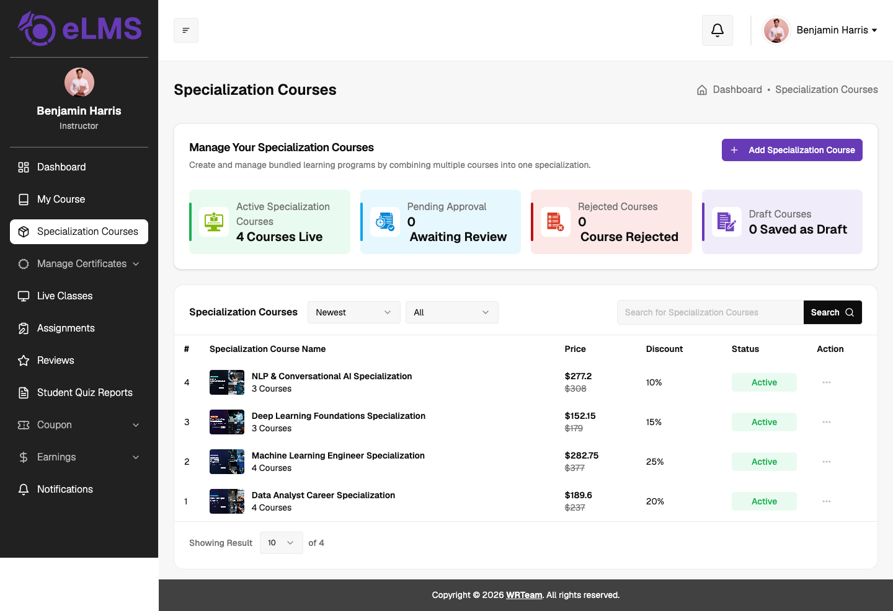
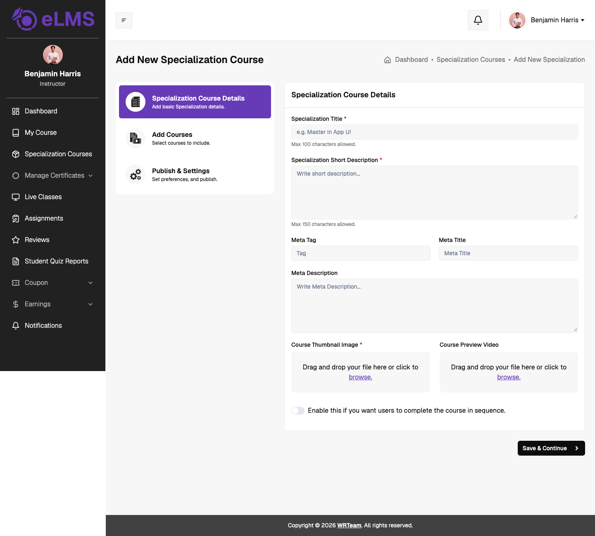
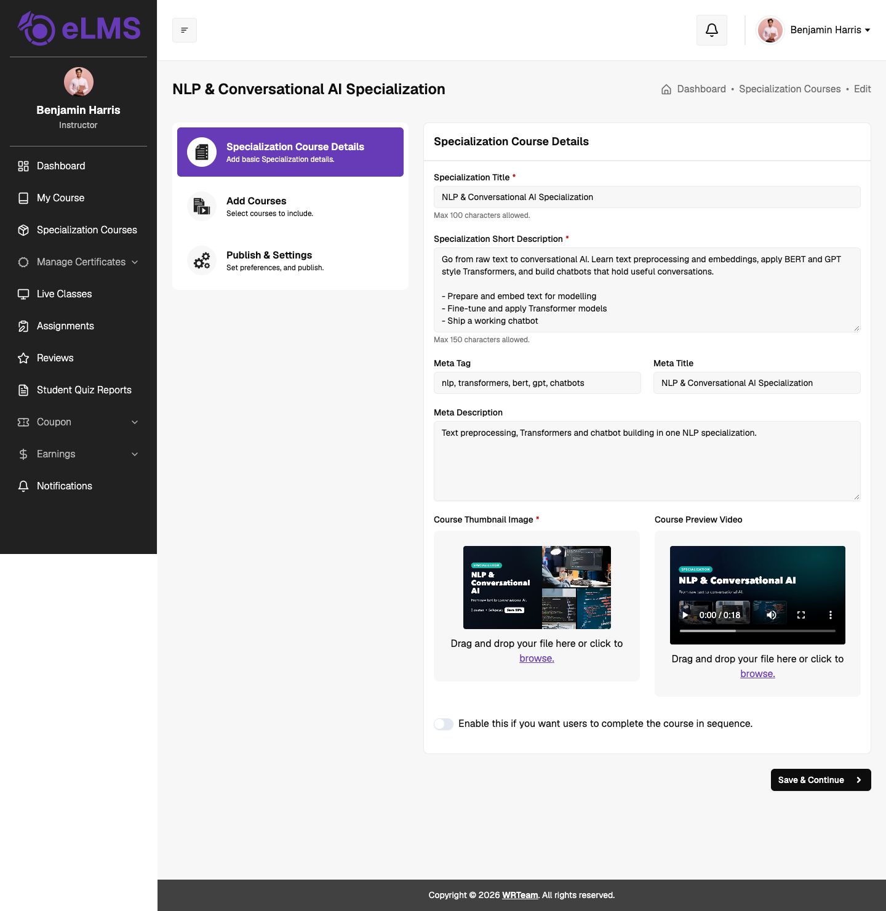
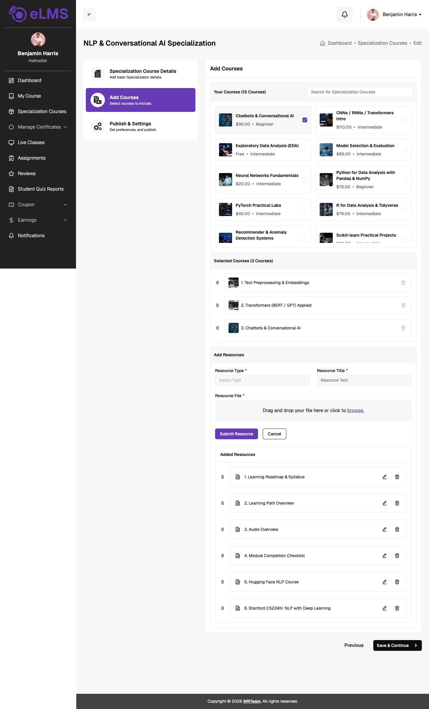
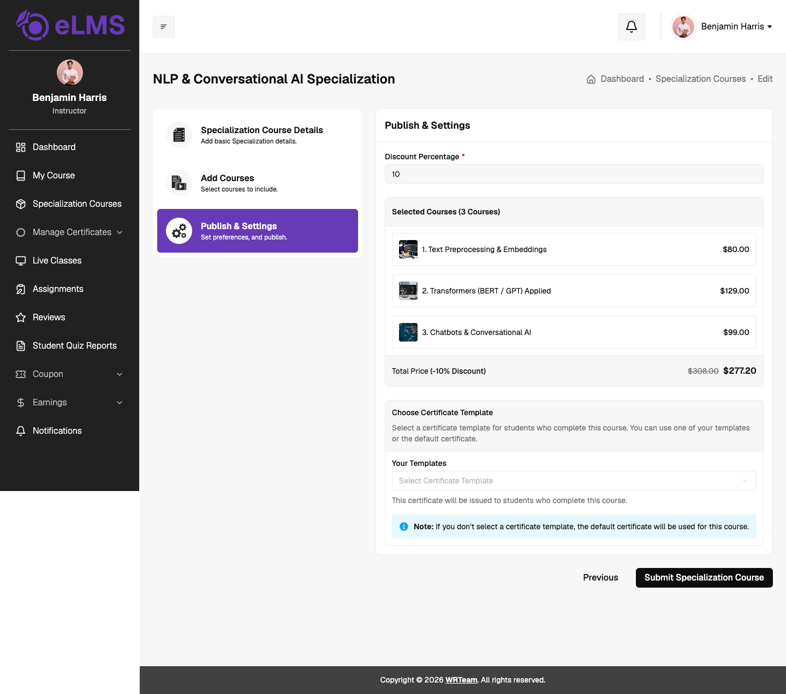
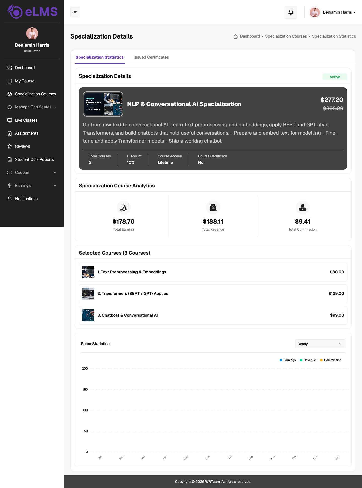
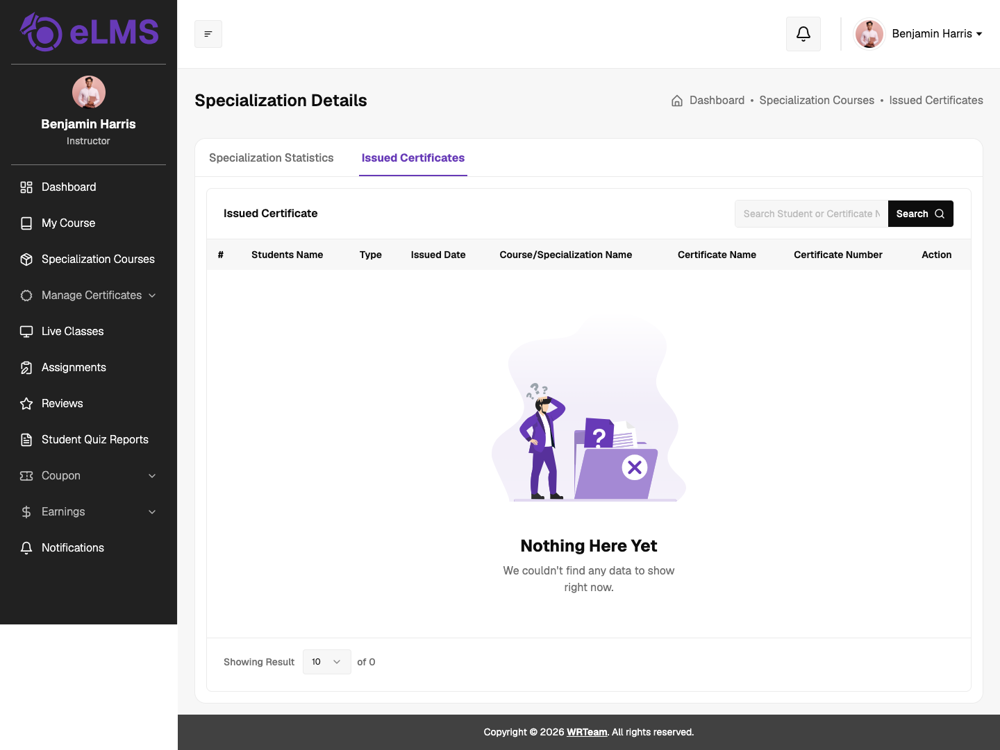

# Specialization Courses

A specialization course bundles several of the instructor's courses into one program that learners buy together at a discount. The Specialization Courses page lets instructors create, edit and track their specializations from a single place.

### Overview

Displays specialization counts grouped by their current status: Active, Pending Approval, Rejected and Draft.

### Specialization Listing

Lists all of the instructor's specializations with the thumbnail, name, number of courses, price (with the original price struck through), discount and status. The list can be sorted (for example Newest) and filtered by status, and searched by name. Each row has an **Action** menu with:

- **Edit** – opens the specialization in edit mode.
- **View Details** – opens the specialization statistics page.
- **Delete** – removes the specialization.

---

## Create & Edit Specialization

Click **Add Specialization Course** to create a new specialization, or choose **Edit** from the Action menu to change an existing one. The form opens pre-filled when editing. The process has three steps:

### Step 1: Specialization Course Details

Defines the basic information:
- **Specialization Title** (*Required*): Title of the specialization (Max 100 characters).
- **Specialization Short Description** (*Required*): Short summary of what learners will get (Max 150 characters).
- **Meta Tag**, **Meta Title** and **Meta Description**: SEO details used by search engines.
- **Course Thumbnail Image** (*Required*): Cover image shown on the specialization card.
- **Course Preview Video**: Optional preview video.
- **Sequential access**: Turn on to make learners complete the courses in order, one after the other.

Click **Save & Continue** to move to the next step.

When editing, the saved title, description, SEO details, thumbnail and video are already filled in. Use the file area to replace the thumbnail or video.

### Step 2: Add Courses

Selects the courses and any extra learning material:
- **Your Courses**: Every course the instructor has, with its price and level. Tick the courses to include, or use the search box to find one.
- **Selected Courses**: The chosen courses in the order learners will follow. Drag to reorder, or use the bin icon to remove one.
- **Add Resources**: Attach extra material with a **Resource Type** (Image, Audio, Video, External URL or Document), **Resource Title** and **Resource File** (or URL), then click **Submit Resource**. Added resources are listed below the form and can be reordered, edited or deleted.

### Step 3: Publish & Settings

Sets the price and certificate, and submits the specialization:
- **Discount Percentage**: Discount applied to the bundle. The selected courses are listed with their prices, and the **Total Price** shows the original and discounted price.
- **Choose Certificate Template**: Pick one of your own certificate templates for learners who complete the specialization. If none is selected, the default certificate is used.

Click **Submit Specialization Course** to finish. Use **Previous** to go back to an earlier step.

---

## Specialization Details

**View Details** opens the specialization with two tabs.

**Specialization Statistics** shows:
- **Specialization Details**: Thumbnail, title, status, price, description, total courses, discount, course access and whether a certificate is attached.
- **Specialization Course Analytics**: Total Earning, Total Revenue and Total Commission.
- **Selected Courses**: The courses in the bundle with their prices.
- **Sales Statistics**: A chart of earnings, revenue and commission, filterable by period.

**Issued Certificates** lists the certificates issued to learners for this specialization, with the student, type, issued date, certificate name and certificate number. It can be searched by student or certificate number.
