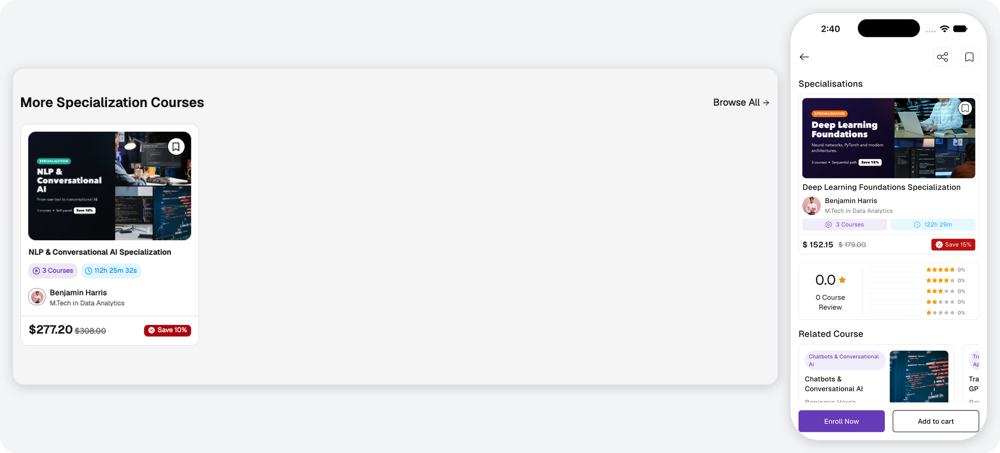
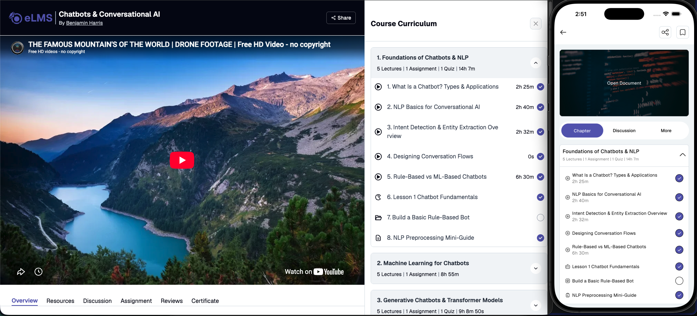

# Course Details

Users can view complete course information from the course details page. The following information is displayed:

- Course banner, title, category, instructor, level, duration, and language.
- Description, learning outcomes, requirements, and certificate information.
- Preview video, pricing details with discounts, wishlist toggle, enrollment and cart actions.
- Course includes information, curriculum with chapters and lectures, and social sharing options.
- Coupon application and course ratings and reviews.
- Free preview lectures and curriculum contents accessible before enrollment.

If the course is part of one or more [specializations](./specializations.md), they are listed on this page. In the application, this is the Specializations section, with a See All link when there are more than three. On the website, this is the More Specialization Courses section, with a Browse All link.

In multi-instructor mode, the instructor details section is also shown, including the instructor's profile, ratings, biography, qualifications, and skills.

