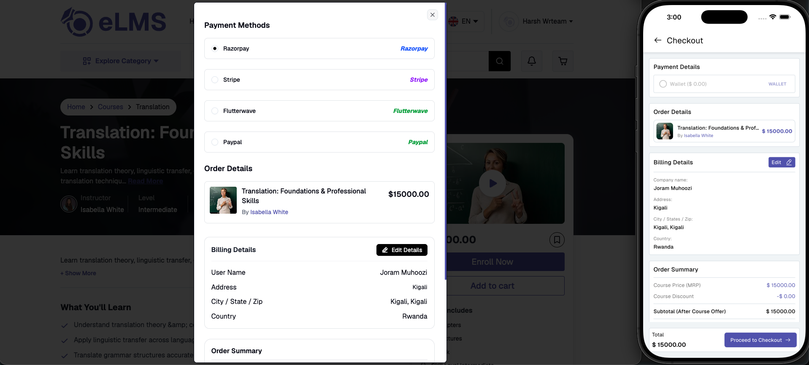

# Course Enrollment & Orders

Users can directly enroll in free courses with a single tap. For paid courses, users can either purchase the course directly or add it to the cart for later checkout.

- **Single Course Purchase** – Applicable instructor and admin coupons can be applied.

- **Cart Checkout** – For multi-course purchases through the cart, only admin-added coupons are supported.
- **Specialization Purchase** – [Specializations](./specializations.md) can be purchased directly or through the cart, together with other items. Courses the user already owns are not charged again, and adding a specialization to the cart removes any of its courses already in the cart. Coupons for specializations are applied from the cart or, on the website, from the specialization details page.
- **Checkout Details** – Users can select from available payment gateways, provide or update billing details for invoicing, and review the order summary including discounts, taxes, and the payable amount before completing payment.
- **Wallet Payment** – Users can pay using their wallet balance if sufficient funds are available. Wallet balance can be added through course refunds or in-app purchases on iOS.

