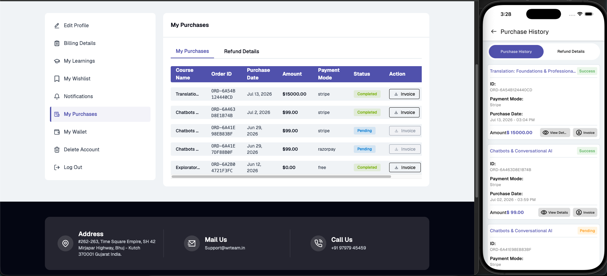
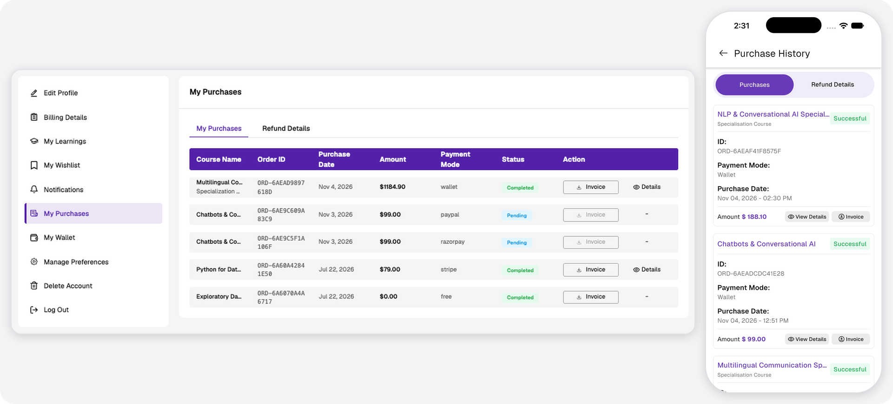
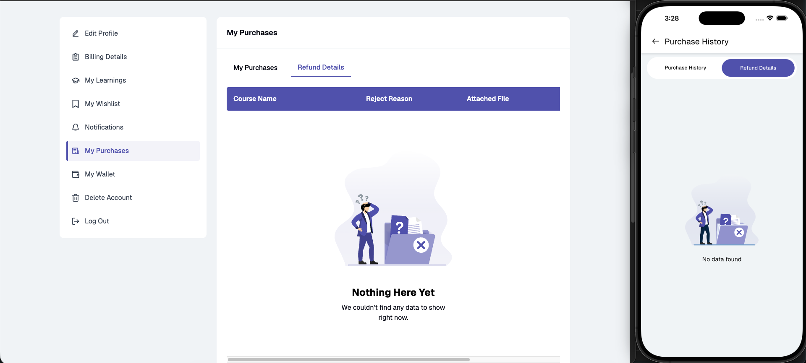

# My Purchases & Refunds

Users can view all purchased courses and specializations with the following details for each: purchase date, amount, payment method, payment status, invoice download option, and a purchase details view.

**Purchase Details:**
- Shows purchased course information and allows eligible users to submit a refund request.
- Refund requests support a reason field and optional media attachments.
- Approved refunds are credited to the user's wallet.
- A specialization is refunded as a whole. Courses purchased as part of a [specialization](./specializations.md) are shown under it and cannot be refunded individually.

**Refund Tracking:**
- Users can track refund requests separately with refund status, attached files, and rejection reasons where applicable.
- Refund requests are only available for courses and specializations where refunds have been enabled and where the purchase is within the eligible refund window.

