# Specializations

A Specialization is a bundle of related courses offered as a single learning path. Users enroll once and get access to all of its courses, along with a combined price, an optional discount, exclusive resources, and a certificate for completing the full bundle.

Specializations are available in the mobile application and the website when the feature is enabled from the admin panel. When it is disabled, every Specialization section, tab, and listing is hidden, and only courses are shown.

## Workflow Overview

1. **Discover** – Find a Specialization from the home page, the Specializations listing, or a course that belongs to one.
2. **Review** – Open the details page to check the included courses, resources, instructor, certificate, and price.
3. **Enroll** – Enroll directly or add the Specialization to the cart, then complete checkout.
4. **Learn** – Open the Specialization from My Learning and complete its courses while progress is tracked.
5. **Earn the Certificate** – Once every course is completed, pay the certificate fee if one applies, and download the certificate.

## Discovering Specializations

Users can find Specializations from the following places:

- **Home Page** – A Specializations featured section shows Specialization cards. **See All** in the application, or **Browse All** on the website, opens the full listing.

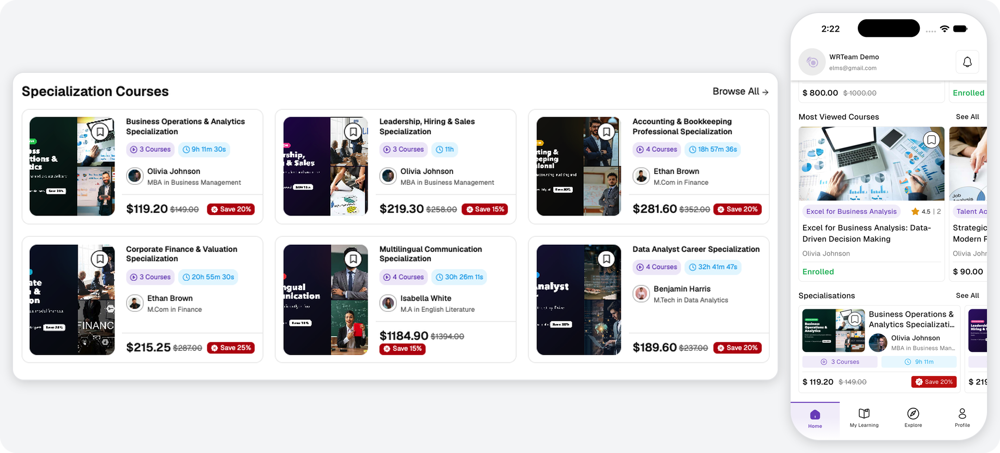

- **Specializations Listing** – On the website, the **Specialization** menu opens the full listing. In the application, the Explore tab has a toggle to switch between **Courses** and **Specializations**.
- **Course Details** – When a course is part of one or more Specializations, the course details page lists them in a dedicated section.
- **Shared Links** – A shared Specialization link opens its details page directly.

Each card displays the image, title, instructor, course count, total duration, and price, along with a wishlist toggle.

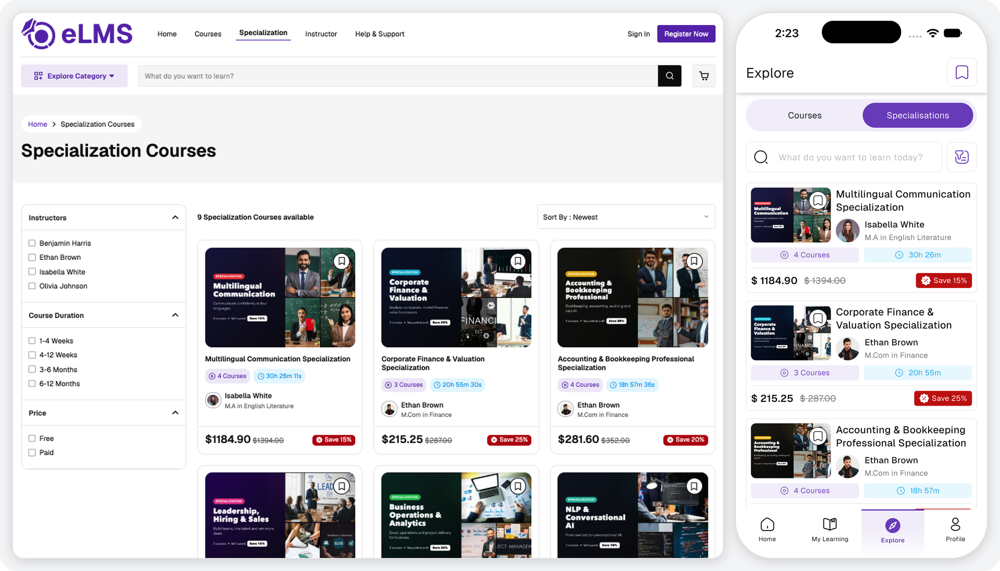

**Search & Filters:**

Users can narrow the listing with the following filters. The application also includes a keyword search on the listing, and the website includes a sort option.

| Filter | Options |
|--------|---------|
| Instructors | One or more instructors. |
| Course Duration | 1-4 Weeks, 4-12 Weeks, 3-6 Months, 6-12 Months. |
| Price | Free or Paid. |

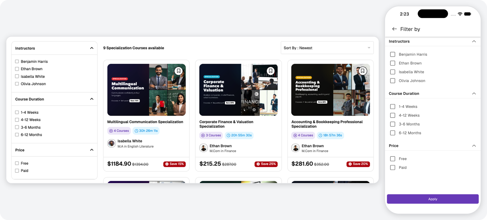

## Specialization Details

The details page is available before enrollment and shows the following information:

- **Overview** – Image, preview video if one has been added, category, title, course count, total duration, level, and description.
- **Specialization Courses** – Every course in the bundle, with its image, title, chapters, duration, and price or status. Tapping a course opens it. On the website, this section is called **Courses Included in Specialization**.
- **Exclusive Resources** – Files and links included with the Specialization. These remain locked until the user enrolls.
- **Instructor** – Rating, name, and qualification, with a link to the instructor's profile.
- **Specialization Certificate** – A preview of the certificate that can be earned.
- **More Specializations** – In the application, other Specializations from the same instructor.
- **Specialization Course Includes** – On the website, a summary of the category, duration, lifetime access, and certificate availability.

Users can also share the Specialization or add it to their wishlist from the top of the page.

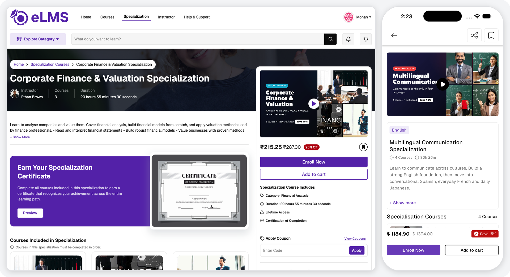

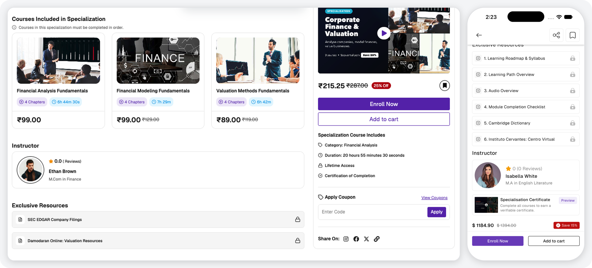

## Pricing

The price is calculated for each user. Courses the user already owns are not charged again, and the Specialization discount is then applied to the remaining amount. The purchase options on the details page change accordingly:

| Situation | What the user sees |
|-----------|--------------------|
| Paid Specialization | Payable price, original price, discount tag, **Enroll Now**, and **Add to Cart**. |
| Some courses already owned | A message showing how many of the courses the user already owns, with the reduced price, **Enroll Now**, and **Add to Cart**. |
| Free, or nothing left to pay | **Free** with **Enroll Now**. |
| All courses already owned | **Enroll in Specialization**, with nothing to pay. |
| Already enrolled | No purchase options. Progress is shown instead. |

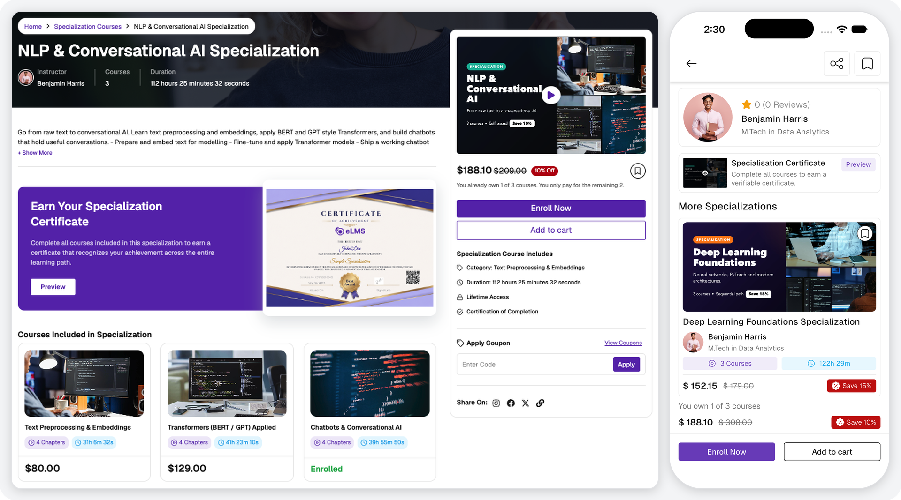

## Enrolling in a Specialization

Users must be logged in to enroll or add a Specialization to the cart. There are two ways to purchase:

- **Enroll Now** – Goes straight to checkout for that Specialization. A Specialization with nothing to pay is enrolled through the same step without a payment.
- **Add to Cart** – Adds the Specialization to the cart so it can be purchased together with other items. Any of its courses already in the cart are removed so they are not purchased twice. Once it is in the cart, the button on the details page changes to **Remove from Cart**.

Coupons can be applied from the cart. On the website, they can also be applied from the **Apply Coupon** section of the details page. In the application, the **Enroll Now** checkout does not include a coupon option, so users who want to use a coupon should purchase through the cart.

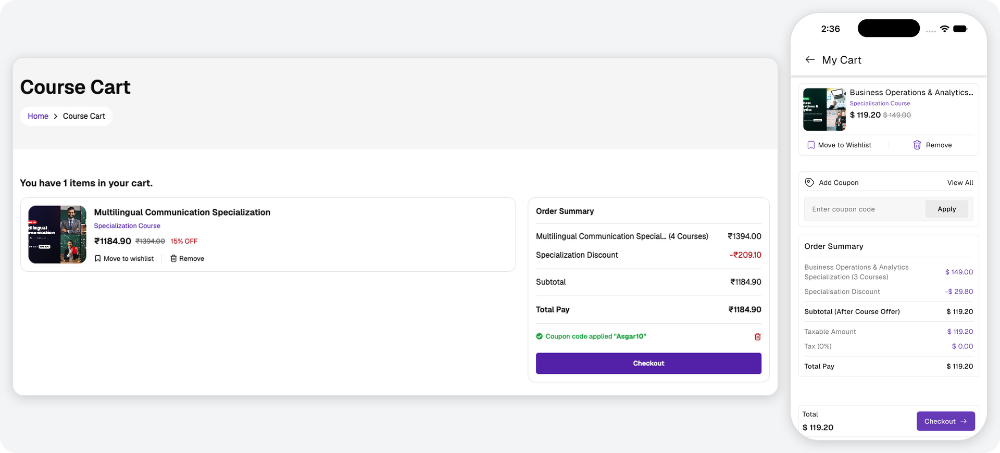

**Checkout:**

The order summary lists each Specialization with its course count, followed by the deductions for owned courses and the Specialization discount. Payment methods, billing details, wallet payment, and iOS wallet rules work the same way as for courses. See [Course Enrollment & Orders](./enrollment-orders.md).

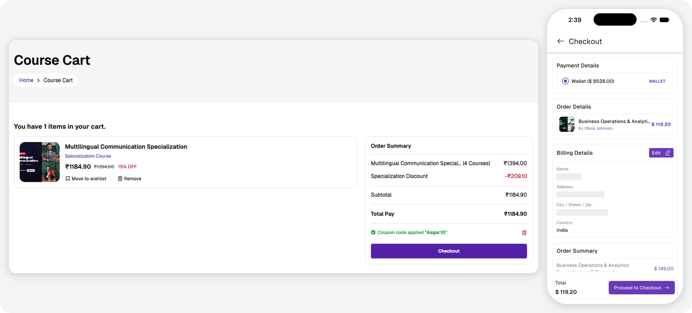

After a successful payment, a confirmation is shown with an **Access Specialization** button, which opens the Specializations tab in My Learning.

## Learning & Progress

Enrolled Specializations are listed under **My Learning → Specializations** in the application, where they can be filtered by **All**, **Ongoing**, and **Complete**. On the website, they are listed under **My Learnings → Specialization Courses**, with a filter on the same page. Each card shows the title, progress percentage, and completed course count.

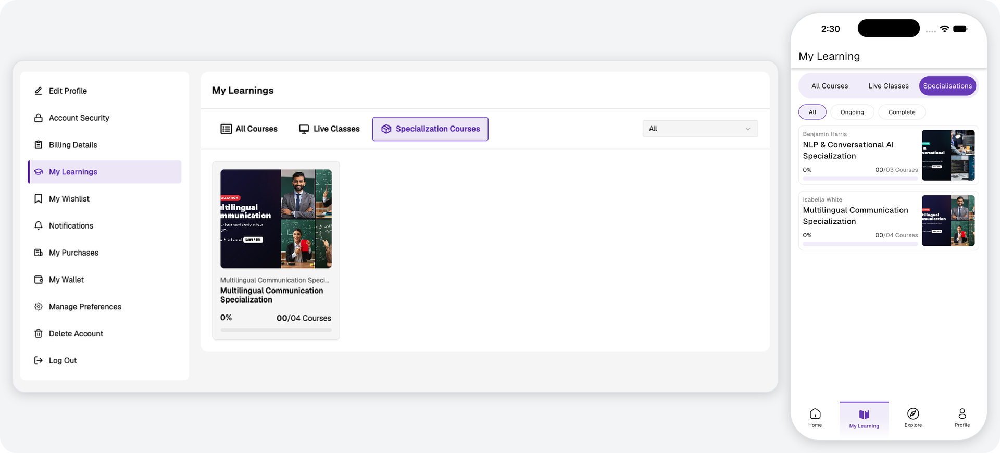

Opening an enrolled Specialization shows the same details page with the following changes:

- **Course Progress** – Each course shows its progress percentage and completed chapters. Tapping a course opens it, and the course is completed in the usual way. See [Curriculum & Completion](./curriculum-completion.md).
- **Specialization Progress** – Overall progress, along with how many of the courses have been completed.
- **Exclusive Resources** – Unlocked and ready to open.
- **Course Order** – A Specialization can require its courses to be completed in order. On the website, a note above the course list says so, and the later courses stay **Locked** until the earlier ones are completed.
- **Locked Courses** – A course the user no longer owns, such as after a refund, is also marked as **Locked** and cannot be opened. Purchasing the Specialization again restores it.

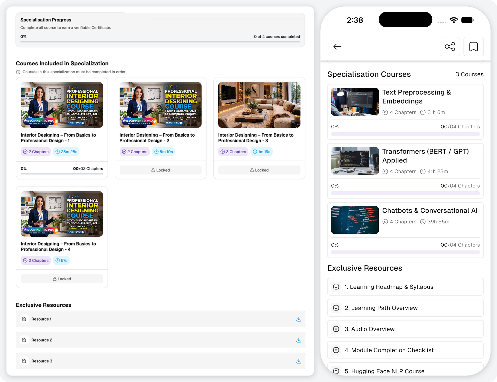

## Specialization Certificate

The Specialization certificate is separate from the certificates of the individual courses. It is opened from the **Specialization Certificate** card on the details page, and moves through the following stages:

| Stage | What the user sees |
|-------|--------------------|
| Courses not completed | A sample of the certificate, opened with the **Preview** button on the details page. In the application, the sample is shown locked, and the download option remains disabled until all courses are completed. |
| Completed, fee required | A **Purchase Certificate** button with the fee amount, when a certificate fee applies. |
| Completed, nothing to pay | The user's own certificate with a **Download Certificate** button. |

The certificate fee can be paid using the wallet or an available payment method. On iOS, it can be paid with wallet balance only. Certificate purchases appear in the user's purchase history.

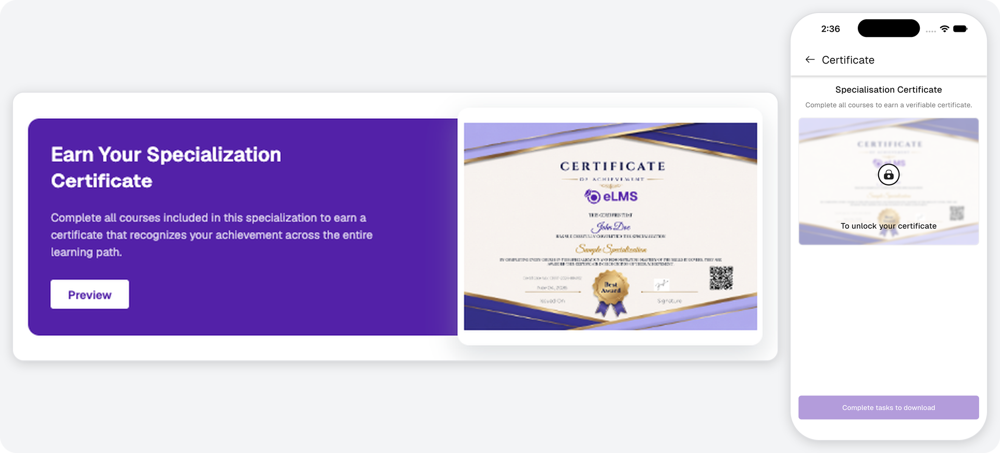

## Wishlist, Purchases & Refunds

- **Wishlist** – Saved Specializations appear in their own tab in the wishlist. See [Other Features](./other-features.md).
- **Purchase History** – Specialization orders are listed with the user's other purchases. See [My Purchases & Refunds](./purchases-refunds.md).
- **Refunds** – A refund applies to the whole Specialization in an order. Courses purchased as part of a Specialization cannot be refunded individually.
